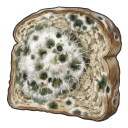
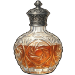

# Anno 1800: Return to the Orient

[![mod.io](https://img.shields.io/badge/mod.io-Mod_Page-07c1d8?logo=)](https://mod.io/g/anno-1800/m/return-to-the-orient#description)

For centuries, the Sultanate has remained isolated from the outside world, preserving its ancient traditions and resisting change.
The Sultan's invitation is therefore remarkable and could be a unique opportunity for business, research and to increase your politcal influence.
Few foreigners have ever been welcome, yet rumours of unrest spread across the desert, as many seek the prosperity and inventions of the Industrial Age.

Your task is to establish a settlement in this deserted land, build a thriving city and introduce the Sultanate to the wonders of modern industry, while balancing progress with tradition.

## Feature Overview

- A new hot and dry desert region inspired by the middle east.
- A new questline from Madame Kahina that leads you on an expedition deep into the sultanate and to the new session Wadi Al Zahir.
- Nomads and Envoys can settle there with their own buildings, needs and public services, just like 400 years ago.
- Use norias to water your fields in the desert in a new irrigation system.
- New production chains require resources from all across the rest of your empire to produce the required new wares.
- Consulates are central to the bureaucratic work of envoys and create the paper work for special events and buildings that connect the east and west.
- Introduce your curious envoys with Old and New Word wares via a modular bazaar system for further research.
- Build a new monument with its own special events for additional influence.
- Settle Scholars with alternative needs and without build permits.
- Enjoy 1404's music playing in the background.
- Over 30 new ornaments to distract your population from the desert heat.
- Madame Kahina joined you on your journey and is willing to help you by trading new wares and new orient-specific items.
- Use the Foreign Trading Company to import needed wares for the envoys that you might not be able to produce yourself.
- Produce special mixtures to refine more ores and boost your Old World Smelters.
- Delight your Population in other worlds by bringing them foreign products from the orient.

## Requirements & Compatibility

Required DLCs: Land of Lions

Optional DLCs: High Life, Tourist Season, Bright Harvest, Empire of the Skies and New World Rising

The mod is compatible with new and existing saves, regular and creative modes. Campaign and multiplayer were not tested but should work.

No other mods are required but could be useful for the production of shared wares.
Other mods should be compatible, this includes mods that add new regions (New Horizons) and new sessions (Kingsgrove, Mayabeque etc.).
Recommended optional mods: Noblesse Oblige (Ricky & Taludas) and New Horizons. With New Horizons, you also get some new and exclusive content.

The mod content starts with a quest to complete an expedition by Madame Kahina.
To unlock the quest and expedition you need to have 3000 Investors, 1800 Obreras and 1000 Elders.

## New Products that can be used by other mods

| Icon | Product | GUID |
|------|---------|------|
|| Alembics | 1404005115 |
|| Arak | 1404005120 |
|| Astrolabes | 1404005131 |
|| Flotation Concentrate | 1404000879 |
|| Moldy Bread | 1404005095 |
|| P. Parasiticum | 1404005054 |
|| Oudh Perfume | 1404005059 |
|| Oudh | 1404005058 |
|| Sultans Seals | 1404000207 |

These products are added by the mod, but are specific to the Orient. This is the reason why they can be used by other mods, but not produced independently. This can change in the future.

## Credits

### Development

- [Natoncy](https://github.com/Natoncy)
- [Intetsch](https://github.com/Intetsch)
- Satanoy (Item development and icons)

### Shared Mods

#### Misc & General

- shared_Neutral Hacienda Base by Genshi
- shared_general_modules_kurila by Kurila
- spice_powder_kurila by Kurila
- shared_TooltipBugFixes
- shared_ObjectDummies_serp by serp
- shared_Pools and Definitions
- jakob-skyscraper-button by jakob
- shared_decals_industry_jakob by jakob
- shared_ow_tools_jakob by jakob
- shared_jakob_tools by jakob
- shared_olive_oil_jakob by jakob
- shared_olives_jakob by jakob
- shared_incense by taubenangriff
- shared_sulfur_production_lion053 by lion053
- shared_production_silver_bars

#### Import Docks & Trading Companies

- Natoncy_shared_importdock_honey by Natoncy
- Taludas_shared_importdock_ebony by Taludas
- Taludas_shared_tradingcompany by Taludas

#### Products

- [Product] PalmLeaf_Satanoy by Satanoy
- [Product] Shared_Date_Satanoy by Satanoy
- [Product] Shared_Roses_fridhmyr by fridhmyr
- [Product] Shared_rosenwasser_fridhmyr by fridhmyr
- shared_agarwood_fridhmyr by fridhmyr

#### Storage Lists

- import_storagelist_almonds_taludas by Taludas
- import_storagelist_ebony_taludas by Taludas
- import_storagelist_silkfabric_taludas by Taludas

#### Portraits (Natoncy)

- Natoncy_portrait_1404_26_nomad by Natoncy
- Natoncy_portrait_1404_27_envoy by Natoncy
- Natoncy_portrait_1404_28_al_zahir by Natoncy
- Natoncy_portrait_1404_29_sultan by Natoncy
- Natoncy_portrait_1404_30_assassin by Natoncy
- Natoncy_portrait_1404_31_caravanserai by Natoncy
- Natoncy_portrait_1404_32_alchemist by Natoncy
- Natoncy_portrait_1404_33_scholar by Natoncy

---

### Developed for Return to the Orient

**Natoncy:**

- shared_importdock_honey
- sharedproduct_camels
- sharedproduct_ceremonial_sabers
- sharedproduct_chandeliers
- sharedproduct_hookahs
- sharedproduct_kaftans
- sharedproduct_mosaic
- sharedproduct_pearl_necklaces
- sharedproduct_pomegranate_juice
- sharedproduct_rugs
- sharedproduct_turbans

**Intetsch:**

- sharedproduct_palm_wood
- sharedproduct_spiced_tea
- sharedproduct_lokum
- sharedproduct_candied_dates
- sharedproduct_pistachios
- sharedproduct_aniseed
- sharedproduct_copper_bar
- sharedproduct_hummus
- sharedproduct_roasted_chickpeas
- sharedproduct_chickpeas

## Translation

- German: Natoncy
- French: TBD
- Italian: TBD
- Japanese: TBD
- Korean: TBD
- Polish: TBD
- Russian: TBD
- Spanish: Satanoy
- Simplified Chinese: TBD
- Traditional Chinese: TBD
(all languages are still available, but translated with AI)
